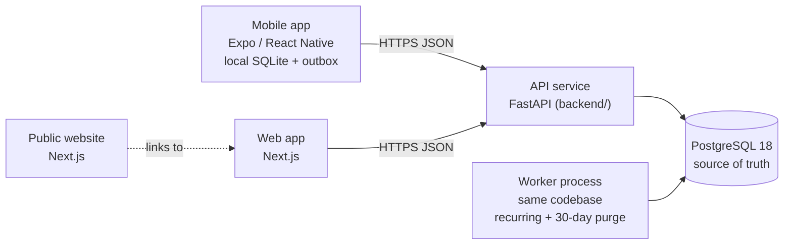

# Mulya — Target Architecture (v0.2 — Day 3 additions over accepted v0.1)

Task: **MLY-005**. Status: v0.1 accepted on 16 Oct 2026. **v0.2 expands §9 (auth design) and updates §6; becomes binding when you commit it.** Accepted decisions are recorded in workbook sheet `20_Decisions`.
Binding companion: `docs/CONVENTIONS.md` (v0.3). Where this document and CONVENTIONS disagree, CONVENTIONS wins.

---

## 1. Scope and constraints

- **Launch:** Android + Web. iOS later (Expo keeps that cheap).
- **Builder:** one person. So: boring technology, one codebase per tier, **no infrastructure beyond PostgreSQL** until a real need appears.
- **Offline-first mobile, server-authoritative sync** (D-10).
- **The database is the source of truth for invariants** (balances, no-overdraft, workspace isolation). The API adds friendly validation on top; it never replaces the database rules.

## 2. System context



No Redis, no message queue, no separate auth service in v1.

## 3. Repository layout

```
ExpenseManagementApp/            (this repo; legacy Android lives at the root, frozen at tag native-v2.26)
├─ app/, gradle/, ...            legacy Android — untouched until mobile work starts
├─ backend/                      FastAPI + Alembic                          ← Day 2
├─ db/                           SQL test suite + the historical schema_v0.sql baseline
├─ docs/                         CONVENTIONS, ARCHITECTURE, TEST_MATRIX, tracking/
├─ apps/mobile/                  Expo app                                   (MLY-013)
└─ apps/web/                     Next.js                                    (MLY-017)
```

- **Source of truth for the schema = `backend/alembic/versions`.** `db/schema_v0.sql` is the frozen Day 1 baseline (migration 0001 is a byte-for-byte copy).
- **ADR-R1 (repo layout).** Before `apps/mobile` starts, move the legacy Android project into `legacy-android/` in **one commit** using `git mv` (history is preserved). Until then leave it: moving it now would break your working Android Studio setup for no benefit.

## 4. Backend structure and rules

```
backend/app/
  main.py          create_app(), router wiring
  core/            config, money, (later) errors, security
  db/              engine + the per-request transaction
  api/             health (unversioned) and v1/ routers
  features/<name>/ router.py · schemas.py · service.py · queries.py     (added feature by feature)
```

1. **Routers are thin:** parse → call service → return a response model.
2. **Services own business rules** and run inside the request's single transaction (`get_db`). Services never call `commit()`.
3. **SQL lives in `queries.py`** (SQLAlchemy Core / `text()`), no ORM sessions for now: the schema relies on triggers, generated columns and partial indexes that an ORM would hide.
4. **Database enforces, API validates.** Both, never one.
5. **Always use a `response_model`.** FastAPI's raw-dict encoder turns `Decimal` into a float.
6. **Database access is synchronous** (ADR-B1 below).

## 5. Money across layers

| Layer | Representation | Rule |
|---|---|---|
| PostgreSQL | `NUMERIC(20,8)` major units | exact arithmetic |
| Python | `Decimal` | `Amount` type + `validate_amount_for_currency` (`app/core/money.py`) |
| JSON | string `"450.00"` | JSON numbers are rejected |
| TypeScript | string + a decimal library | never JS `number` arithmetic |
| SQLite (mobile) | `TEXT` | arithmetic only via one `Money` module; **no SQL `SUM()`** (SQLite aggregates are floating point) |
| Display | `format(amount, currency, locale)` | one formatter per client |

### ADR-M1 — Local money storage on mobile

Your Day 1 decision (decimal major units) is fine in PostgreSQL, but SQLite has no exact decimal type. Options:

| Option | Exact? | Problem |
|---|---|---|
| **A. TEXT + app-side decimal math** *(recommended)* | yes | Balances are summed in JS from rows. Fine at personal-finance scale (tens of thousands of rows). |
| B. Integer scaled by 10⁸ | yes | SQL sums work, but the upper bound 10¹¹ × 10⁸ = 10¹⁹ **overflows int64** (max ≈ 9.22×10¹⁸), and JS needs BigInt. Only viable if the bound is lowered. |
| C. Integer minor units locally, convert at the sync boundary | yes | Re-introduces the conversion layer you rejected on Day 1. |

**Spike (30–60 min, before mobile work, part of MLY-013):** load 50,000 transactions into expo-sqlite as TEXT, compute all account balances with the Money module, record the time. If it is acceptable (target: well under a second on a mid-range phone), option A stands.

## 6. Invariants — where each one is enforced

| Invariant | Database | API | Test |
|---|---|---|---|
| Balance is derived | view `v_account_balances` | — | SQL suite: balances |
| Transfer legs cancel (same currency) | enforced at COMMIT (0003, deferred trigger) | service writes the transfer and both legs in ONE transaction | SQL suite §10 |
| Cross-currency legs agree with `fx_rate` | enforced at COMMIT (0003) | pass `fx_rate`; legs in account-id order | SQL suite §10 |
| No overdraft (insert / update / delete / move / limit change) | triggers + per-account row lock | map `account_no_overdraft` → 422 | SQL suite §9 + concurrency test |
| Analytics exclude transfers and adjustments | — (query rule) | shared query helper | SQL suite: analytics |
| Workspace isolation | composite foreign keys | workspace comes from the token's membership | SQL suite: cross-workspace |
| Recurring: once per date | PK `(rule_id, occurrence_on)` | catch-up generator (MLY-021) | SQL suite: recurring |
| Currency decimals | trigger + `currencies` table (0003) | `validate_amount_for_currency` | SQL suite §10, `test_money`, `test_currencies` |
| Stale write (409) | `version` bumped by trigger | compare `base_version` | trigger tested; API to write |
| Idempotent create | PK = client UUID | `ON CONFLICT DO NOTHING` + return existing | to write (MLY-019) |

## 7. Errors (API contract)

Shape: `{"type": "...", "title": "...", "status": 422, "code": "overdraft", "detail": "..."}`.
Clients switch on `code`, **never on message text**.

| Database / validation event | HTTP | `code` |
|---|---|---|
| constraint `account_no_overdraft` (SQLSTATE P0001) | 422 | `overdraft` |
| unique violation (23505) | 409 | `conflict` |
| foreign-key (23503) / check (23514) violation | 422 | `invalid_reference` / `invalid_value` |
| `version` mismatch | 409 | `stale_version` (body carries the current row) |
| deadlock (40P01) | retry once, then 503 | `busy` |
| request validation | 422 | `validation_error` |

## 8. Background jobs (design only — MLY-021)

The worker is **the same codebase in a separate process** (`python -m app.worker`) that loops every few minutes. Recurring generation and the 30-day purge are plain functions, so tests call them directly. A Postgres advisory lock guarantees one runner. Everything is idempotent. No queue service.

## 9. Auth and sync boundaries (design only)

### Auth design v0.1 — PROPOSAL (accept or edit on Day 4, before any auth code)

| Topic | Proposal |
|---|---|
| Login methods | E-mail one-time code and Google ID token. Apple only when iOS ships. **No passwords, no phone OTP.** |
| One-time code | 6 digits, valid 10 minutes, at most 5 attempts (the database enforces `attempts <= max_attempts`), at most 5 codes per e-mail per hour, a new code invalidates the previous one. Stored as a SHA-256 hash. |
| Access token | JWT, 15 minutes, carries user id and device id. Workspace access is looked up from membership, not put in the token. |
| Refresh token | Opaque 256-bit random value, stored as a SHA-256 hash, valid 60 days, **rotating**: each refresh issues a new token in the same session and marks the old one `used_at` / `replaced_by`. **Presenting an already-used token is treated as theft:** revoke the whole session (`reuse_detected`). |
| Device | One row per installed app or browser; revoking a device revokes its tokens. |
| Development mode | Codes are printed to the server console ("console mailer"). A real e-mail provider is chosen before beta. |
| Secrets | Signing key in `.env` for now (never committed). |

**Already enforced by migration 0004:** hashes are exactly 32 bytes; a token's device must belong to the same user; revoked ⇔ has a reason; a code cannot exceed its attempts; e-mails are lower-case; a Google subject links to one user only.

- **Sync (MLY-010 spike → MLY-022):** client-generated UUIDs; an outbox of idempotent writes; pull by a server sequence cursor; tombstones via `deleted_at`; balances never synced.
- Auth tables exist (migration 0004). Sync tables (change feed, cursors) wait for the MLY-010 spike.
- **Offline vs the no-overdraft rule (ADR-S1).** The database rejects any write that would overdraw an account. Two offline devices can each record a spend that is valid locally; when the second one syncs, the server answers 422. The sync design must say what happens to that already-recorded transaction (see §12). It must **never** be silently dropped.

## 10. Environments

- **Dev:** your Windows laptop, PostgreSQL 18 service, backend in a venv. No Docker needed.
- **Test:** database `mulya_test`, wiped each pytest session (guarded: the name must match exactly).
- **CI (later task):** GitHub Actions with a PostgreSQL 18 service container, running `pytest`.
- **Hosting (later):** Docker image (D-08); prefer managed Postgres with restores you have actually tested.

## 11. Decision log (D-01 … D-21)

"Proposed" = my recommendation; you set the real status in `20_Decisions`.

| ID | Decision | Proposed | Notes |
|---|---|---|---|
| D-01 | Web: Next.js + React | Accept | Public site and authenticated app in one Next.js project (route groups). Starts after the mobile MVP. |
| D-02 | Backend: FastAPI | Accept | Sync SQLAlchemy 2 + psycopg 3 for now (ADR-B1). This **revises my earlier "async" suggestion**. |
| D-03 | DB: PostgreSQL | Accept (changed) | Money is `NUMERIC(20,8)` major units (your Day 1 decision), not integer minor units. PostgreSQL 18 required (`uuidv7()`). |
| D-04 | Cache: Redis | Defer | Not in v1. Revisit on the first real need (rate limiting, queues). Postgres covers jobs. |
| D-05 | API: REST | Accept | Cursor pagination, idempotent creates, the error shape in §7. |
| D-06 | Local mobile DB: SQLite | Accept with ADR-M1 | Money stored as TEXT. |
| D-07 | Auth: central backend auth | Accept | Email OTP + Google. Apple deferred until iOS ships (no iOS at launch). |
| D-08 | Hosting: Docker | Accept | Dev stays Docker-free; Dockerfile belongs to the deployment task. |
| D-09 | Public website + authenticated app | Accept | |
| D-10 | Offline-first, server-authoritative sync | Accept | Together with D-18. |
| D-11 | Account abstraction + user ownership | Accept | Implemented in schema v0.1 (users, workspaces, members, accounts). |
| D-12 | Mobile: React Native + Expo | Accept, conditional | Conditional on the money spike (ADR-M1) and a charts spike. |
| D-13 | Money and ID conventions | Accept — **fix the wording** | The workbook row still says "Integer minor units". It should say decimal major units `NUMERIC(20,8)`, UUIDv7, `date` + `timestamptz`. |
| D-14 | Balances derived from the ledger | Accept | Implemented (view + adjustment transactions). |
| D-15 | Recurring engine: server-side, idempotent | Accept | Schema done; generator is MLY-021. |
| D-16 | Sync engine: build vs adopt | Needs Research | Decided by the MLY-010 spike. Not today. |
| D-17 | Workspace model | Accept | Implemented. |
| D-18 | Local-only mode | Accept, mobile only | Offline-first means sync is simply off until sign-in; web requires an account. |
| D-19 | Legacy data migration | Accept, reduced | Your decision: owner-only import, P2. |
| D-20 | Native Android app | Accept | Frozen at tag `native-v2.26` (done). |
| D-21 | Terminology: Workspace | Accept | Implemented in the schema. |

## 12. New decisions raised on Day 2

- **ADR-B1 — Synchronous database access.** **[ACCEPTED]** SQLAlchemy 2 + psycopg 3, synchronous; FastAPI runs sync endpoints in a threadpool.
  Why: one driver for the app and Alembic; the endpoints are I/O-light; avoids psycopg async event loop quirks on Windows. Revisit if profiling shows threadpool saturation.
- **ADR-M1 — Local money storage.** **[ACCEPTED - Option A]** See §5. Recommended: Option A (TEXT decimal strings + client-side decimal arithmetic via Money module), confirmed by a 30–60 min spike in MLY-013.
- **ADR-R1 — Repo layout.** **[ACCEPTED]** See §3. Recommended: move legacy Android files into `legacy-android/` in one git commit before `apps/mobile` starts.
- **ADR-S1 — Offline overdraft conflicts.** **[ACKNOWLEDGED - Option A]** Decide formally in MLY-010 sync spike. Client enforces the floor locally; writes rejected by the server are flagged "needs attention" for the user to resolve, never silently dropped.
- **ADR-A1 — Auth data model.** **[PROPOSED]** Session = a device's refresh-token chain (no sessions table); only hashes are stored; rotation with reuse detection (§9). Accept on Day 4.
- **ADR-I1 — Legacy import.** **[PROPOSED]** A pure mapper (`app/legacy/mapper.py`) produces a reviewable plan with issues; ids are deterministic; scope is owner-only (D-19); goals and scheduled payments are counted but not imported until their tables exist. Accept on Day 4.
- **ADR-L1 — Ledger edits.** **[ACCEPTED]** Editable + soft-delete + `version` bumping; audit log of previous values added later; **no rigid immutability**.
